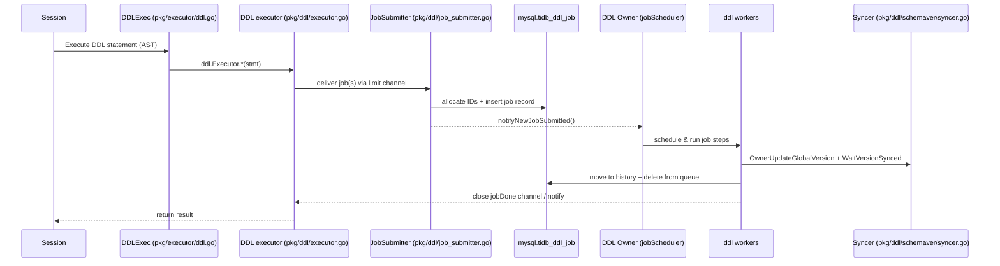

# DDL Execution: Read-First Index

TiDB DDL is **job-based** and **owner-driven**: a SQL DDL statement is converted into a persistent DDL *job*, then the **DDL owner** schedules and runs the job on workers, gradually changing schema states and waiting for schema version synchronization across TiDB nodes.

The most common mistake is to implement “DDL behavior” directly in `pkg/executor/` (SQL executor layer). That usually bypasses:

- Job persistence / owner failover (resumability).
- Schema state machine (`delete only` → `write only` → `reorg` → `public`).
- Schema version + diff update, and cluster-wide schema sync.
- MDL / lease based safety mechanisms.

This doc set is meant to be **the first thing to read** before touching DDL-related code.

## Caveat (debugging and drift)

- Debugging: You may use these docs as a starting point, but you **MUST** validate conclusions against code/tests. Treat unverified statements as hypotheses (avoid hallucination/outdated assumptions).
- Drift: If implementation and `docs/agents/ddl/*` diverge during design/development, you **MUST** update the docs to match reality and call it out in the PR/issue.

## Agent preflight (questions)

Before touching `pkg/ddl/`, answer these explicitly (write them down in the PR/issue if possible):

1. Is it **job-based** (persist/resume/failover) or a **metadata-only fast path**?
2. Does it require **schema state transitions** (and which ones), or can it stay `public` throughout?
3. Does it require a **reorg/backfill scan** (read/write workload), and what is the checkpoint/persistence point?
4. What are the **cancel/rollback** semantics? Which step(s) are reversible, and which need delete-range GC?
5. How does it affect **schema version + schema diff** and follower schema sync?
6. What are the **system tables** / durable metadata involved (`mysql.tidb_ddl_job`, `mysql.tidb_ddl_reorg`, ...)? Which fields must be backward compatible?
7. What is the **expected online behavior** (MDL / blocking, write conflicts, phase boundaries)?
8. What is the **minimal regression test** (unit/integration), and which failpoints can make it deterministic?

## Index (by task)

- Understand end-to-end call chain: `docs/agents/ddl/01-execution-flow.md`
- Job state machine / schema state machine / schema sync: `docs/agents/ddl/02-job-lifecycle.md`
- Any reorg/backfill (ingest, checkpoint, distributed backfill): `docs/agents/ddl/03-reorg-backfill.md`
- Where-to-change + test patterns: `docs/agents/ddl/04-dev-checklist.md`
- “Where is this implemented?” file map: `docs/agents/ddl/05-file-map.md`
- Add-index behavior (fast reorg, ingest, backfill-merge): `docs/agents/ddl/06-add-index.md`
- Modify-column behavior (reorg types, null/not-null, type change): `docs/agents/ddl/07-modify-column.md`
- Partition DDL (add/drop/truncate/reorganize/exchange): `docs/agents/ddl/08-partition-ddl.md`

## Operation index (jump table)

### Column DDL

- Modify column / change column: `model.ActionModifyColumn` → `docs/agents/ddl/07-modify-column.md`

### Index DDL

- Add index / add primary key: `model.ActionAddIndex`, `model.ActionAddPrimaryKey` → `docs/agents/ddl/06-add-index.md`

### Partition DDL

- Add/drop/truncate partition: `model.ActionAddTablePartition`, `model.ActionDropTablePartition`, `model.ActionTruncateTablePartition` → `docs/agents/ddl/08-partition-ddl.md`
- Reorganize / exchange partition: `model.ActionReorganizePartition`, `model.ActionExchangeTablePartition` → `docs/agents/ddl/08-partition-ddl.md`

## Mental model (one-minute skim)

1. `pkg/executor/ddl.go` (`DDLExec`) receives a DDL AST node and calls into the DDL module.
2. `pkg/ddl/executor.go` converts the statement to a `model.Job` (or multiple jobs), then **submits** it via `JobSubmitter`.
3. `JobSubmitter` allocates IDs, writes the job into `mysql.tidb_ddl_job`, and notifies the owner-side scheduler.
4. Only the **DDL owner** runs `jobScheduler`, which dispatches jobs into worker pools.
5. Workers run the job **step-by-step** (meta changes + schema state transitions), update global schema version, then wait for followers to sync.
6. When done, the job is moved to history; the submitting session is unblocked and returns success/failure.

## Execution flow diagram

## Diagnostic schema loading

Diagnostic mode continues to use the ordinary Etcd schema syncer. The Domain
schema-sync loop and InfoSchema reloads remain active so a diagnostic instance
can load the existing schema, while MDL checking is skipped. Diagnostic startup
requires an already bootstrapped keyspace and reads persisted startup settings
without writing them back.

`serverinfo.Syncer` does not register or refresh server and topology records in
diagnostic mode; the independent Domain server-ID lease remains active. Its
server-info sync loop returns immediately, also skipping that loop's
min-start-ts reporting.

Diagnostic session bootstrap calls `Domain.StartDiagnostic` instead of
`Domain.Start`, bypassing `DDL.Start` and its execution resources. `DDL.Start`,
`EnableDDL`, and `DisableDDL` themselves have no diagnostic-mode guard;
`SwitchMDL` returns `diagnosticmode.ErrDDLNotAllowed`. Cross-keyspace runtimes
skip server-info, MDL, and min-job-ID refresher background loops in diagnostic
mode.

## Code map (where to look first)

### Front-end (SQL executor layer)

- `pkg/executor/ddl.go`: `type DDLExec`, `(*DDLExec).Next` dispatches AST → DDL module; handles transaction boundary and converts schema-outdated errors.

### DDL module (job-based execution)

- `pkg/ddl/ddl.go`: `NewDDL` wires everything; `(*ddl).Start` starts submit loop and campaigns owner.
- `pkg/ddl/executor.go`: `type Executor` (called by SQL layer); converts statements → jobs; `DoDDLJobWrapper` waits for job completion.
- `pkg/ddl/job_submitter.go`: `type JobSubmitter` batches submission, allocates IDs, inserts into job table, and notifies scheduler.
- `pkg/ddl/job_scheduler.go`: owner-only scheduler; `ownerListener.OnBecomeOwner` starts `jobScheduler` and worker pools.
- `pkg/ddl/job_worker.go`: worker logic; `transitOneJobStep` / `runOneJobStep` drive state transitions and meta updates.
- `pkg/ddl/schema_version.go` + `pkg/ddl/job_worker.go:updateGlobalVersionAndWaitSynced`: global schema version update + `WaitVersionSynced`.
- `pkg/ddl/schemaver/syncer.go`: `type Syncer` implements schema version synchronization (etcd-based).
- `pkg/ddl/systable/manager.go`: storage access for job/MDL related system tables.

### Cluster integration

- `pkg/domain/domain.go`: creates DDL via `ddl.NewDDL(...)`; initializes infosync + schema syncer, and orchestrates startup order.

## Reading order

1. `docs/agents/ddl/01-execution-flow.md` — end-to-end call chain and responsibilities.
2. `docs/agents/ddl/02-job-lifecycle.md` — job/version/state machines, schema sync, owner/failover.
3. `docs/agents/ddl/03-reorg-backfill.md` — reorg/backfill and distributed backfill overview.
4. `docs/agents/ddl/04-dev-checklist.md` — where-to-change, testing, and common pitfalls.
5. `docs/agents/ddl/05-file-map.md` — quick “where is this implemented?” map inside `pkg/ddl/`.
6. `docs/agents/ddl/06-add-index.md` — add-index deep dive (fast reorg, ingest, backfill-merge).
7. `docs/agents/ddl/07-modify-column.md` — modify-column deep dive (reorg types, state machine).
8. `docs/agents/ddl/08-partition-ddl.md` — partition DDL deep dive (state machine, reorg, GC).

## Related design docs (deep dives)

- Distributed DDL reorg: `docs/design/2022-09-19-distributed-ddl-reorg.md`
- Add index acceleration / ingest: `docs/design/2022-06-07-adding-index-acceleration.md`
- Multi-schema change: `docs/design/2022-04-15-multi-schema-change.md`
- Pause/Resume DDL: `docs/design/2023-04-15-ddl-pause-resume.md`
- Pause user DDL while upgrading: `docs/design/2023-04-11-pause-user-ddl-when-upgrading.md`
- Dist task framework: `docs/design/2023-04-11-dist-task.md`

## Rust internal transactional CREATE TABLE prototype

The Go owner/worker flow above remains the normal DDL contract. The Rust
PostgreSQL public entry still rejects transaction-block DDL. Internal
`ConcreteSession` execution supports ordinary persistent CREATE TABLE on its
existing user transaction: `DdlMetadataService::stage_create_table` writes the
canonical table metadata and schema version without committing, and the session
writes the durable DDL history entry on that same transaction. A private schema
allows the creator's subsequent DML to resolve the table. Other sessions continue
to use committed metadata. User COMMIT publishes the schema after KV commit;
ROLLBACK discards metadata, history and rows together. Existing transaction MDL
is retained until the user transaction ends. MySQL keeps its implicit DDL commit.

The creator's INFORMATION_SCHEMA table, column and constraint reads use the
same private schema. For PostgreSQL default-namespace ordinary tables those
three views expose `public` rather than the storage database name, and integer
columns report `integer`. PG catalog providers request the session snapshot
through its worker, so `pg_class` joins also see the creator's pending table.
Other connections read committed metadata; rollback removes the private
snapshot and permits immediate name reuse. The focused visibility tests cover
both the internal session and the existing server catalog provider.

This internal path excludes temporary tables, partitioning, foreign keys,
identity sequences, TTL, explicit region splitting, placement and external
storage attributes. It does not enlist general DDL owner jobs into user
transactions. Its focused regression tests live in
`pkg/session/runtime/pg12_ddl_probe_test.rs`; the real PostgreSQL reference is
collected independently by `pkg/server/testdata/pg12_transaction_libpq.py`.

## Rust PostgreSQL relation ownership

The Rust PostgreSQL catalog stores a creating role ID on table, view and sequence
metadata. Legacy native relations have no implicit PG owner; an administrator
can adopt one with `ALTER TABLE ... OWNER TO ...`. This is a metadata-only change
through `DdlMetadataService::set_postgresql_owner` and the normal Domain metadata
publication path, preserving relation and index IDs and requiring no backfill.
The public PostgreSQL entry still rejects this DDL inside a transaction block.
Native physical partitions do not establish PG partitioned-relation semantics;
PG `PARTITION BY` / `PARTITION OF` DDL is rejected before native parsing or writes,
and a native partition's `pg_class.relkind` projection is rejected rather than
reported as `p` or `I`. Ordinary identities and unrelated relations remain readable.

## Rust PostgreSQL column nullability

The PostgreSQL listener translates `ALTER COLUMN ... DROP NOT NULL` to an
explicit `NULL` column option. An empty option list has a different purpose:
a type-only ALTER preserves the existing constraints. The runtime PostgreSQL
MODIFY COLUMN path scans the shared stored rows before strengthening a nullable
column to NOT NULL and returns SQLSTATE `23502` before metadata publication if
any value is NULL. Published column flags remain the source of
`pg_attribute.attnotnull`; catalog reads do not infer constraints from samples.
Focused coverage is in `pg13_010_contract`, `pg13_010_differential`, and
`pg13_010_not_null_rejects_existing_null_before_publication`.

## Rust PostgreSQL synchronous index publication

The native ADD INDEX path can publish StatePublic before relational backfill.
PostgreSQL catalog valid/ready fields therefore also require the persisted
IndexInfo.PostgreSQLBuildComplete fact. PG empty-table creation records it in
the atomic table publication; PG ADD INDEX records it through
Domain::ddl_complete_postgresql_index only after backfill_relational_index
succeeds. Legacy indexes without that evidence refuse related PG projections;
reads never migrate metadata. Backfill-merge and transitional native states do
not establish PostgreSQL concurrent-index semantics. The focused catalog and
libpq coverage is pg13_017_contract / pg13_017_differential.
